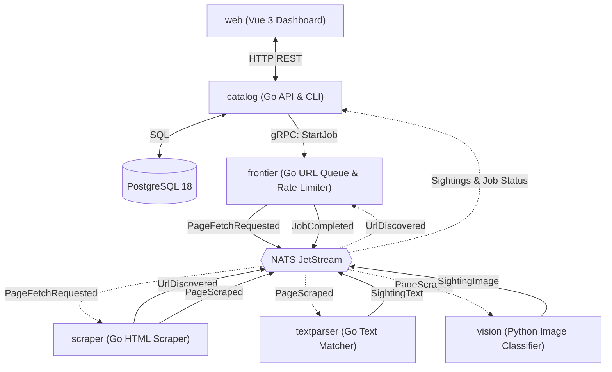

# birdwatcher

[](https://github.com/umutto/birdwatcher/actions/workflows/ci.yml)
[](https://go.dev/)
[](https://docs.astral.sh/uv/)
[](https://vuejs.org/)
[](https://buf.build/)
[](https://nats.io/)
[](https://www.postgresql.org/)
[](LICENSE)

**birdwatcher** is a distributed, event-driven web crawler and bird recognition pipeline built with Go, Python, and Vue 3. Given a starting URL, it crawls web pages, extracts text and images, detects bird species through text matching and computer vision, and indexes every sighting against the 435 plates of John James Audubon's *The Birds of America*.

---

## How It Works

1. **Submit a Job**: A user submits a URL through the Vue dashboard (`web`) or CLI to `catalog` (`POST /api/v1/crawls`).
2. **Schedule URLs**: `catalog` records the crawl in PostgreSQL and calls `frontier` over gRPC (`FrontierService.StartJob`). `frontier` tracks visited links, enforces domain rate limits, and publishes `PageFetchRequested` events to NATS JetStream.
3. **Scrape Content**: `scraper` workers fetch the HTML page, send discovered `<a href>` links back to `frontier` via `UrlDiscovered`, and publish the page title, text, and `` URLs via `PageScraped`.
4. **Detect Birds**: Two services process `PageScraped` in parallel:
   - `textparser` uses Aho-Corasick string matching and text normalization to scan page text for bird common names, scientific names, and aliases, emitting `SightingText`.
   - `vision` downloads page images, classifies birds using a computer vision model, and emits `SightingImage`.
5. **Index Results**: `catalog` consumes sighting and completion events, saves observations to PostgreSQL, and serves crawl progress and the species catalog to the frontend and CLI.

<details open>
<summary><b>System Architecture Diagram</b></summary>



> **Diagram key**: Solid lines (`-->`) show direct requests and published events; dashed lines (`-.->`) show workers subscribing to events from NATS JetStream.

</details>

---

## Services & Packages

| Directory | Stack | Port | Purpose |
| :--- | :--- | :--- | :--- |
| [`services/catalog`](services/catalog) | Go (`net/http`, `pgx`, `sqlc`) | `8080` | Owns PostgreSQL storage, records sightings from NATS, and serves the REST API and CLI. See [README](services/catalog/README.md). |
| `services/frontier` | Go (`gRPC`, NATS) | `9090` | Breadth-first URL queue, visited-link deduplication, `robots.txt` checks, and host rate limiting. |
| `services/scraper` | Go (`net/http`, `goquery`) | — | Stateless worker that fetches HTML and extracts links, text, and image URLs. |
| `services/textparser` | Go (Aho-Corasick, NLP) | — | Worker that scans scraped text for bird names and aliases using Aho-Corasick matching and NLP. |
| `services/vision` | Python 3.14+ (`uv`) | — | Worker that downloads scraped images and runs bird species classification. |
| `web` | Vue 3, TypeScript, Vite, Tailwind v4 | `5173` | Single-page app for browsing the 435-species catalog and monitoring crawl jobs. |
| `proto` & `gen` | Protobuf, Buf v2 | — | Shared gRPC and event schemas (`events.proto`, `frontier.proto`) and generated Go/Python code. |
| `shared/*` | Go | — | Internal packages for config loading (`env`), structured logging (`logger`), NATS (`nats`), and tracing (`telemetry`). |

### NATS JetStream Events

All async events use Protobuf binary encoding on the `BIRDWATCHER` stream (`birdwatcher.v1.>`):

| Subject | Message | Producer | Consumer |
| :--- | :--- | :--- | :--- |
| `birdwatcher.v1.page.fetch` | `PageFetchRequested` | `frontier` | `scraper` |
| `birdwatcher.v1.url.discovered` | `UrlDiscovered` | `scraper` | `frontier` |
| `birdwatcher.v1.page.scraped` | `PageScraped` | `scraper` | `textparser`, `vision`, `catalog` |
| `birdwatcher.v1.sighting.text` | `SightingText` | `textparser` | `catalog` |
| `birdwatcher.v1.sighting.image` | `SightingImage` | `vision` | `catalog` |
| `birdwatcher.v1.job.completed` | `JobCompleted` | `frontier` | `catalog` |

---

## Prerequisites

Make sure the following runtimes are installed on your system (Linux / macOS / WSL2):

- **Go** `1.27+`
- **Python** `3.14+` with [**uv**](https://docs.astral.sh/uv/)
- **Node.js** `24+` with [**pnpm**](https://pnpm.io/)
- **Docker** & **Docker Compose**

Install the project development tools (`buf`, `sqlc`, `goose`, `golangci-lint`, `air`, `sqruff`):

```bash
make tools
```

---

## Getting Started

### 1. Configure Environment Files

Copy the example environment files for Docker Compose and each service:

```bash
cp .env.example .env
for svc in catalog frontier scraper textparser vision; do
  cp "services/$svc/.env.example" "services/$svc/.env"
done
```

### 2. Start Local Infrastructure & Seed Data

Start **NATS JetStream** (`localhost:4222`, monitoring at `http://localhost:8222`) and **PostgreSQL 18** (`localhost:5432`), apply schema migrations, and seed the Audubon catalog:

```bash
make up
make migrate
make seed
```

### 3. Set Up Git Hooks

Enable the pre-push hook to check for `sqlc`, `buf`, and `go.work.sum` drift before pushing:

```bash
make setup-hooks
```

### 4. Run the Application

```bash
# Run Catalog API with live reload (http://localhost:8080)
make dev

# Run Go workers (in separate terminals)
go run ./services/frontier
go run ./services/scraper
go run ./services/textparser

# Run Python vision worker
cd services/vision && uv run vision

# Run Vue 3 frontend (http://localhost:5173)
cd web && pnpm install && pnpm dev
```

---

## API & Documentation

- **Catalog HTTP REST API**: Full endpoint documentation and health probes are documented in [`services/catalog/README.md`](services/catalog/README.md).
- **Event & gRPC Schemas**: Protobuf contracts for async NATS JetStream events and gRPC service definitions are located in [`proto/birdwatcher/v1`](proto/birdwatcher/v1).

---

## CI/CD & Deployment

- **Continuous Integration (`.github/workflows/ci.yml`)**: Path-filtered GitHub Actions verify Protobuf schemas (`buf`), SQL generation (`sqlc`, `sqruff`), Go race-enabled tests and linters (`golangci-lint`), Python suites (`ruff`, `pytest`), and frontend builds.
- **Container Registry**: Pushes to `main` build multi-stage Docker images published to GitHub Container Registry (`ghcr.io/umutto/birdwatcher/<service>`).
- **Cloud Infrastructure (`deploy/`)**: Zero-cost hosting architecture using Terraform/OpenTofu targeting Google Cloud Run, Neon (serverless PostgreSQL), GCP Compute Engine `e2-micro` (NATS JetStream), and Cloudflare (DNS and CDN).

---

## Project Status (Work in Progress)

- [x] Polyglot monorepo setup (`go.work`, `uv`, `pnpm`) and GitHub Actions CI/CD pipeline
- [x] Protobuf event & gRPC contracts (`buf`) with generated Go and Python stubs
- [x] Shared Go packages for config (`env`), structured logging (`logger`), and NATS JetStream (`nats`)
- [x] PostgreSQL 18 schema, `sqlc` repository layer, and 435-species Audubon dataset & seed tool
- [x] `catalog` HTTP REST API, health probes, and gRPC crawl job dispatch to `frontier`
- [x] `web` Vue 3 + TypeScript + Tailwind v4 + TanStack Query project scaffolding
- [x] `catalog` NATS consumer for recording sightings and crawl progress
- [ ] `frontier` gRPC server, BFS URL queue, deduplication, and host rate limiting
- [ ] `scraper` HTML fetcher and link/text/image extractor
- [ ] `textparser` Aho-Corasick bird name matcher
- [ ] `vision` Python image classification worker
- [ ] `web` dashboard views for browsing the catalog and monitoring crawls

### Stretch Goals & Extensions

- [ ] **Observability**: OpenTelemetry distributed tracing (`shared/telemetry`) across services
- [ ] **Cloud Hosting**: Terraform / OpenTofu zero-cost infrastructure (`deploy/`)
- [ ] **CLI Client**: Terminal client for dispatching crawls and exploring sightings (`catalog/cmd/cli`)

---

## Data Sources & Attribution

- **Illustrations**: John James Audubon, *The Birds of America* (1827–1838), Public Domain. All bird plates are Courtesy of the John James Audubon Center at Mill Grove, Montgomery County Audubon Collection, and Zebra Publishing.
- **Audio Recordings**: Sourced from [xeno-canto.org](https://xeno-canto.org). Individual clips are licensed under Creative Commons (see `metadata.audio` in `species.json` for specific recordists and licenses).
- **Species Summaries**: Sourced from [Wikipedia](https://wikipedia.org) under CC BY-SA 4.0.

## License

MIT — see [LICENSE](LICENSE).
